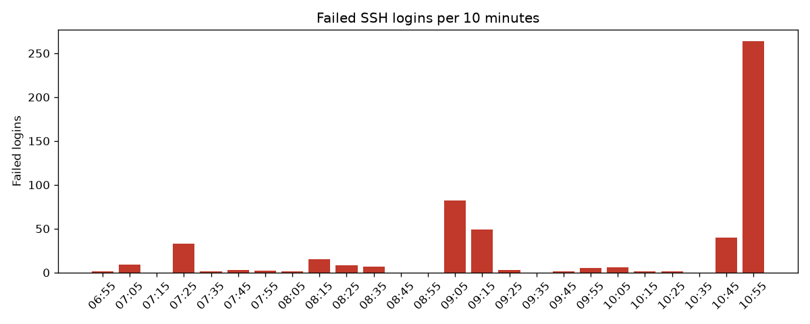
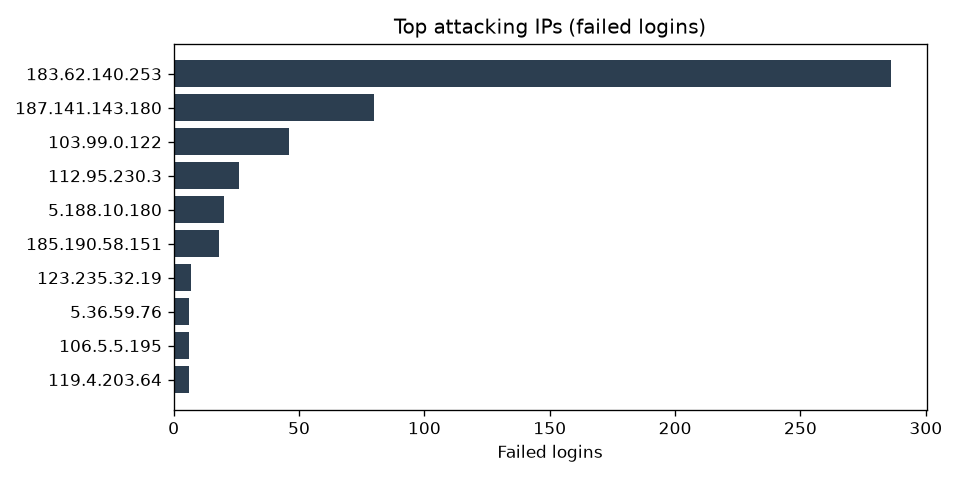
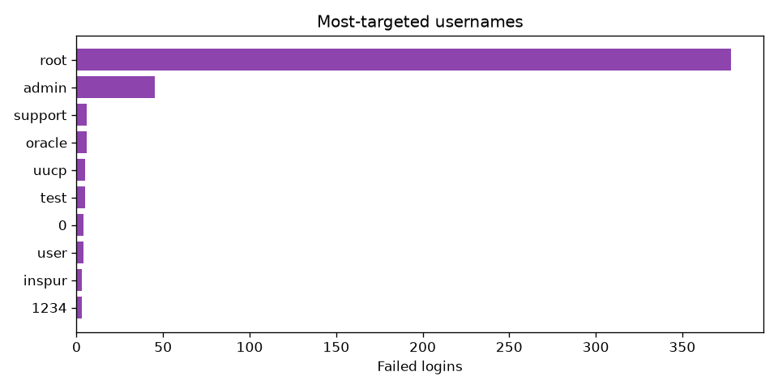

# Log Hunter report

**Source:** `data/OpenSSH_2k.log` (Loghub OpenSSH dataset)  
**Period:** 2025-12-10T06:55:46 to 2025-12-10T11:04:45

## Summary

| Metric | Value |
|---|---|
| Security events parsed | 731 |
| Failed logins | 532 |
| ...on accounts that don't exist | 139 |
| Successful logins | 1 |
| Unique attacking IPs | 24 |

## Alerts

| Severity | Rule | ATT&CK | IP | Detail | First seen | Last seen |
|---|---|---|---|---|---|---|
| high | brute_force | T1110.001 | 183.62.140.253 | 286 failed logins total, peak 147 within 5 min | 2025-12-10 10:54:29 | 2025-12-10 11:04:43 |
| high | brute_force | T1110.001 | 187.141.143.180 | 80 failed logins total, peak 57 within 5 min | 2025-12-10 09:12:48 | 2025-12-10 09:20:02 |
| high | brute_force | T1110.001 | 103.99.0.122 | 46 failed logins total, peak 30 within 5 min | 2025-12-10 09:11:21 | 2025-12-10 11:04:45 |
| high | brute_force | T1110.001 | 112.95.230.3 | 26 failed logins total, peak 26 within 5 min | 2025-12-10 07:27:52 | 2025-12-10 07:28:51 |
| high | brute_force | T1110.001 | 5.188.10.180 | 20 failed logins total, peak 20 within 5 min | 2025-12-10 08:24:35 | 2025-12-10 08:26:24 |
| high | brute_force | T1110.001 | 185.190.58.151 | 18 failed logins total, peak 17 within 5 min | 2025-12-10 09:07:23 | 2025-12-10 09:12:59 |
| medium | username_spray | T1110 | 187.141.143.180 | tried 28 different usernames | 2025-12-10 09:12:48 | 2025-12-10 09:20:02 |
| medium | username_spray | T1110 | 103.99.0.122 | tried 19 different usernames | 2025-12-10 09:11:20 | 2025-12-10 11:04:45 |
| medium | username_spray | T1110 | 183.62.140.253 | tried 10 different usernames | 2025-12-10 10:54:27 | 2025-12-10 11:04:43 |
| medium | username_spray | T1110 | 5.188.10.180 | tried 7 different usernames | 2025-12-10 08:24:32 | 2025-12-10 08:26:24 |
| info | clean_login | - | 119.137.62.142 | login as 'fztu' with 0 prior failures from this IP (looks normal) | 2025-12-10 09:32:20 | 2025-12-10 09:32:20 |

## Most-targeted usernames

| Username | Failed attempts |
|---|---|
| root | 378 |
| admin | 45 |
| support | 6 |
| oracle | 6 |
| uucp | 5 |
| test | 5 |
| 0 | 4 |
| user | 4 |
| inspur | 3 |
| 1234 | 3 |

## Charts

